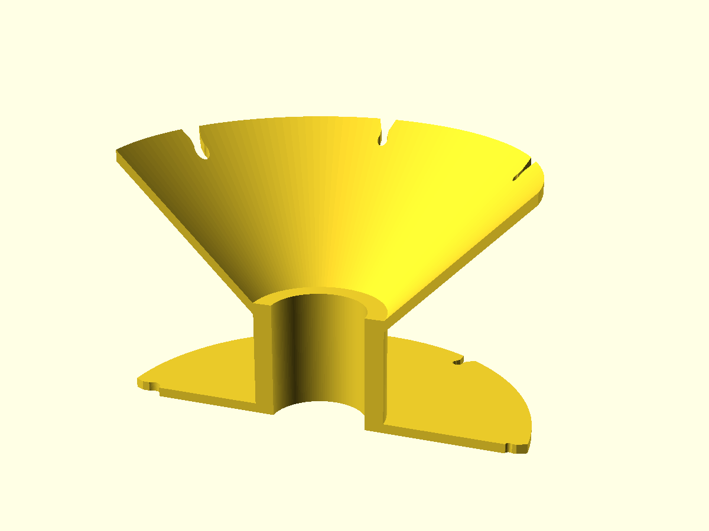
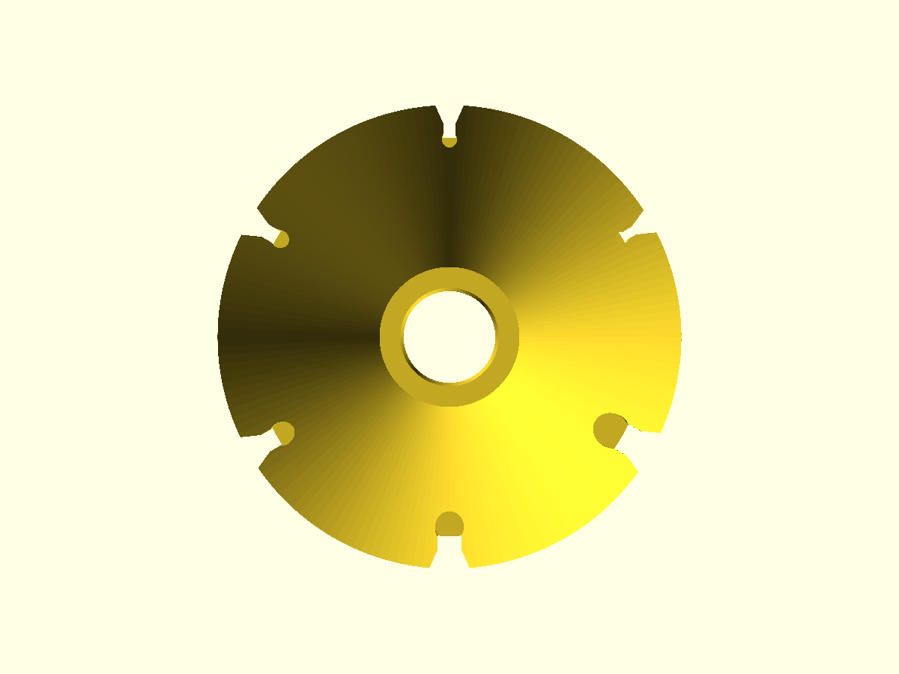
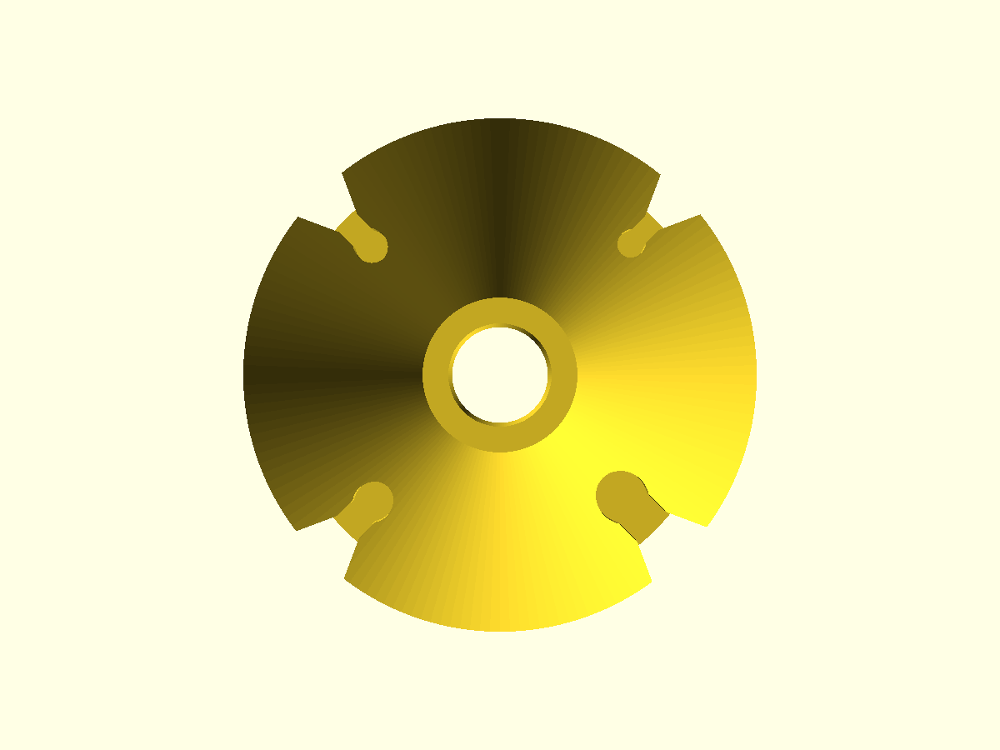

# Cable spool

One-piece spool for a cable of any length and thickness: a hollow core between a flat bottom flange and a 45° conical top flange, so the whole part prints upright with no supports. Each flange carries keyhole slots, each a round pocket behind a neck 0.4 to 1.2 mm narrower than the cable: push a cable end through the neck and the pocket holds it. Wind from one flange's slot, finish in the other's.

| `spool`, top flange | section | `spool_small` | `spool_tiny` |
|---|---|---|---|
|  |  |  |  |

Three sizes share one source; each is a row of `sizes` in [cable-spool.scad](cable-spool.scad), selected by part name.

| part | across × tall | bore | slots (mm) | base / cone wall |
|---|---|---|---|---|
| `spool` | 130 × 81 mm | 30 mm | 2, 3, 4.5, 6, 8, 10 | 3 / 2.6 mm |
| `spool_small` | 82 × 51.7 mm | 19 mm | 2, 2.5, 3, 4, 5, 6 | 2.4 / 2 mm |
| `spool_tiny` | 41 × 27.1 mm | 9 mm | 2, 2.5, 3, 4 | 1.6 / 1.6 mm |

The smaller sizes scale the radii and gap but keep the walls thicker than a straight scale would, for rigidity, and keep 2 mm as the smallest slot so an earbud cord still fits; `spool_tiny` has room for four slots per flange.

[cable-spool.gcode.3mf](cable-spool.gcode.3mf) is sliced for a Bambu Lab A1 mini (0.4 mm nozzle, 0.20 mm Standard, PLA, 3 walls, 15% infill, supports off): 94 g, 2 h 42 min. The slice contains no support and no overhang wall; every wall and surface rests on the line below it apart from sub-millimetre slot corners, and the only bridges are internal skins over sparse infill.

[cable-spool-tiny-x8.gcode.3mf](cable-spool-tiny-x8.gcode.3mf) is eight `spool_tiny` on one A1 mini plate, 51 mm apart in a 3 × 3 grid without its centre, with the same settings and no brim: 49 g, 1 h 59 min, no support.

The conical wall is a revolved cross-section. Subtracting a cone from a clipped
cone made their surfaces coincide at the top rim. OpenSCAD 2021.01 exported
spurious horizontal triangles there, whose triangulation varied across runs.
On the small spool, eight changed triangles accounted for a 0.093731215 mm²
surface-area difference, enough to replace the committed STL and change its
preview despite matching volume, bounds and centroid. Revolving the wall removes
that degenerate rim without relaxing the build's geometry comparison.
Run `nix-shell shell.nix --run 'python3 cable-spool/verify.py'` to check that both
the committed small spool and three fresh exports have no flat top-edge facets.
