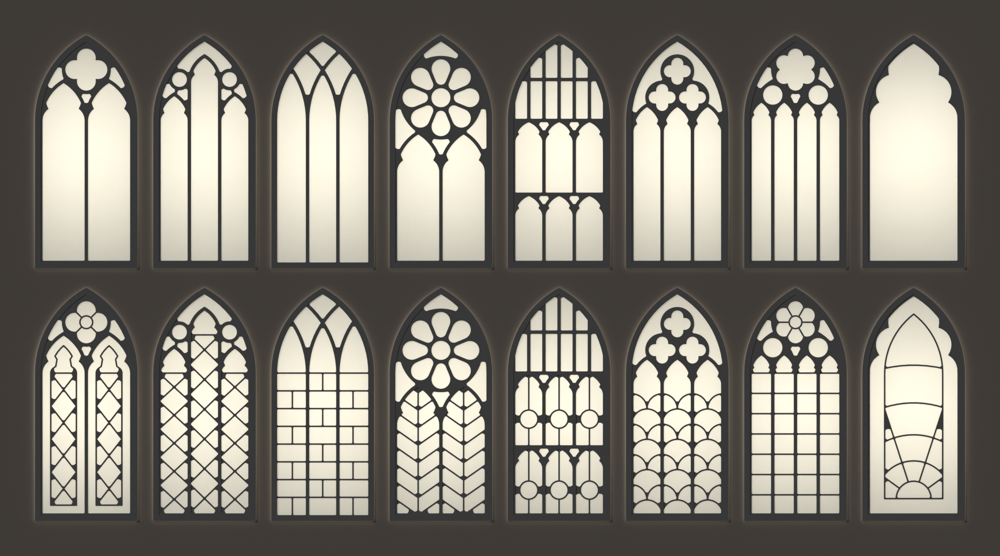
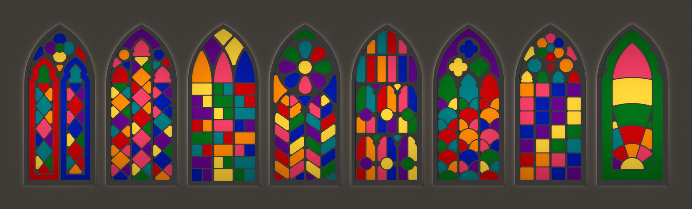
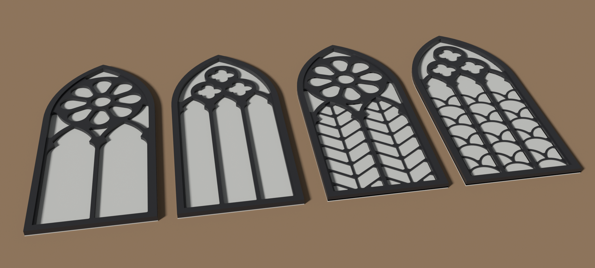

# Gothic windows

Eight small pointed-arch windows from one parametric source, 120 × 52.8 mm and 2.8 mm thick at the default size. Each prints flat as one piece: a thin pane across the whole arch, then the frame and its tracery in a second filament on top of it. Printed in a translucent filament, the pane passes light. A leaded variant adds low ridges that divide the glass into cells to fill with paint.

| render, lit from behind: plain panes above leaded ones | render: leaded cells coloured |
|---|---|
|  |  |

Render, lit from the front: windows 3 and 5, plain and then leaded.

Windows are numbered 0 to 7, left to right in the first two pictures. A light is one glass opening, tracery the bars between lights, a quarry a small pane and a came the strip between two panes.

| window | tracery | leading |
|---|---|---|
| 0 | two cusped lights under a quatrefoil | bordered diamond quarries, quartered quatrefoil |
| 1 | three stepped lancets with roundels | lozenge chains |
| 2 | three lights, intersecting bars | staggered rectangular quarries |
| 3 | two lights under an eight-petal rose | chevrons |
| 4 | panel tracery in two tiers under a head of narrow panels | a roundel on a cross in each tier panel |
| 5 | three lights under a net of three quatrefoils | fish scales |
| 6 | four lights in pairs, a roundel over each pair, under a sexfoil | square quarries, sectored sexfoil |
| 7 | one cinquefoil-headed light | bordered sunburst |

## Parameters

`height` at the top of [gothic-window.scad](gothic-window.scad) scales the outline, the tracery bars and the leading patterns of the whole set; the width is 0.44 of it. Thicknesses and the came width do not scale.

| parameter | default | meaning |
|---|---|---|
| `height` | 120 | window height, mm |
| `pane_z` | 0.4 | pane thickness |
| `tracery_z` | 1.6 | tracery height above the pane |
| `rim_z` | 0.8 | height of the outer moulding above the tracery |
| `came_z`, `came_width` | 0.6, `2 * nozzle` | height and width of a came |
| `min_cell` | `height / 40` | a glass opening or paint cell that a circle of this diameter does not fit is filled in |
| `nozzle` | 0.4 | nozzle diameter; no part of the frame or leading is narrower than 1.2 of it (0.48 mm) |
| `bed`, `gap` | 180, 3 | bed side and spacing between windows on a plate |
| `plates` | `[[0, 1, 2, 3], [4, 5, 6, 7]]` | the windows on each plate; the same number on every plate, because every plate uses the same `pane` and `rim` |
| `plain` | `[]` | positions on a plate whose window the `leading` and `cells` parts leave out, for a plate that mixes the two variants |
| `part` | `"leading_a"` | the part to draw, see Parts |

Asserts reject tracery bars thinner than two nozzle lines (a `height` under 53.4), a `plain` entry that is not a position on the plate, a plate that overflows `bed` (a `height` over 122.9 with the default plates), an empty plate, plates of different sizes and a window number outside 0 to 7.

## Parts

Every part spans all the windows of a plate, with the pane under all of them, so a plate prints with one filament change, after the pane's last layer.

| part | Z, mm | filament | shape |
|---|---|---|---|
| `pane` | 0 – 0.4 | 1 | the arch outline, solid |
| `tracery_a`, `tracery_b` | 0.4 – 2.0 | 2 | frame and tracery |
| `rim` | 2.0 – 2.8 | 2 | outer moulding |
| `leading_a`, `leading_b` | 0.4 – 1.0 | 2 | leaded variant only: the frame's footprint with the cames, overlapping the base of the tracery |

The letter picks a row of `plates`. When every window of a plate fits upright, the plate lays them out in centred rows; otherwise it holds one row of upright windows and the rest turned on their sides above it. `cells_a` and `cells_b` have no STL in `out/`; they are the paint cells as inlays level with the cames, which the painted picture colours.

## Plates

Sliced for a Bambu Lab A1 mini (0.4 mm nozzle, 0.20 mm Standard, two PLA filaments, textured PEI, Arachne walls, no brim, no supports, no prime tower). Filament 1 is the pane, a translucent or natural PLA; filament 2 is the frame. Each plate holds four windows in 14 layers and changes filament once, at layer 3, through an AMS. The pane's two layers are laid at 45° and 135°, so each layer's lines cover the gaps in the other.

| plate | windows | pane filament | frame filament | estimated time |
|---|---|---|---|---|
| [plain a](gothic-window-plain-a.gcode.3mf) | 0 – 3 | 11.15 g | 15.17 g | 1 h 3 min |
| [plain b](gothic-window-plain-b.gcode.3mf) | 4 – 7 | 11.15 g | 15.75 g | 1 h 6 min |
| [leaded a](gothic-window-leaded-a.gcode.3mf) | 0 – 3 | 11.11 g | 16.60 g | 1 h 13 min |
| [leaded b](gothic-window-leaded-b.gcode.3mf) | 4 – 7 | 11.15 g | 16.74 g | 1 h 13 min |

To slice a plate yourself, load `out/pane.stl`, `out/rim.stl` and `out/tracery_a.stl` (`tracery_b` for the second plate) as the parts of one object, so that they keep their places, and add `out/leading_a.stl` for the leaded variant. Give `pane` the first filament and the others the second.

### Sampler plate

[demo/demo.scad](demo/demo.scad) sets `height` to 56 and puts all sixteen windows on one plate, each pattern plain and then leaded: three rows of six, six and four, 162.8 × 174 mm. Its parts are in `demo/out/` and its plate is [demo/gothic-window-demo.gcode.3mf](demo/gothic-window-demo.gcode.3mf): 9.74 g pane filament, 14.98 g frame filament, 1 h 27 min, the same settings as above. The pane is 0.4 mm thick, the cames 0.8 mm wide and the tracery bars 0.84 mm wide. At this size the `min_cell` rule fills two small openings of window 1 and two cells of window 7's sunburst; no bar or came is dropped.

`./render.sh` (needs Nix) regenerates the three pictures with OpenSCAD and Blender.
