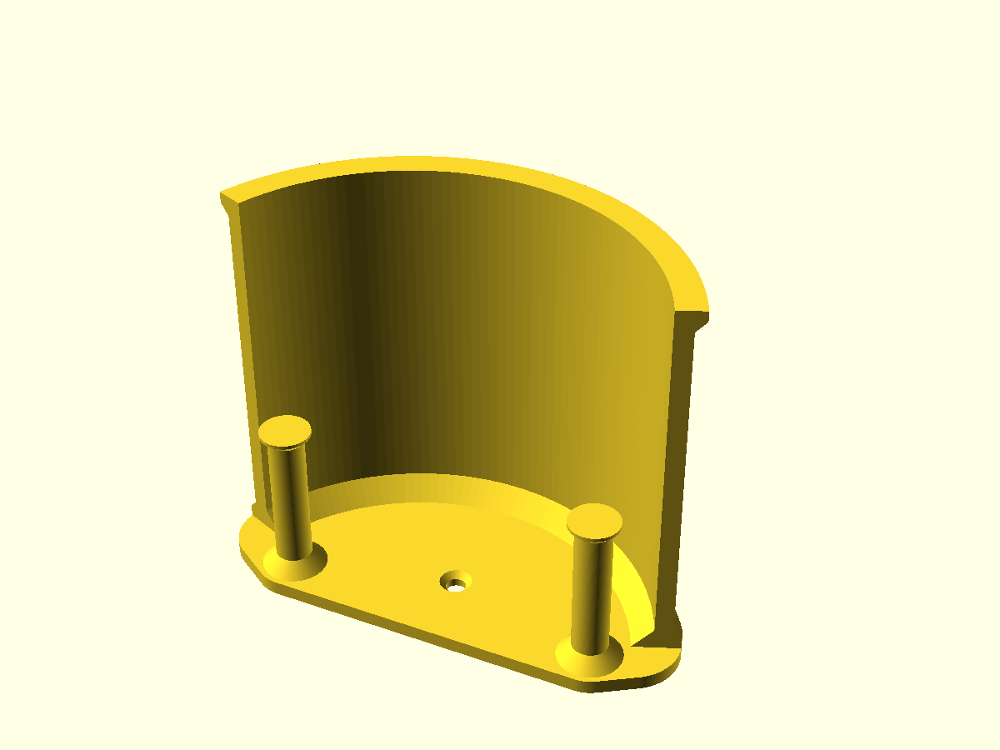

# Headset wall mount

One-piece wall mount for a VR headset and its two controllers. The head strap loops over a curved holder 133 mm wide that stands 110 mm off the wall, with a 3 mm lip at its end so the strap can't slide off; the controllers hang by their wrist straps from two capped pegs below it. Two countersunk screw holes, 68 mm apart, take screws up to 5 mm. A drill reaches both straight on: the lower hole sits inside the holder with a clear 76 mm column above it, the upper one above the holder with a clear 44 mm column.

The holder is one continuous 5 mm wall from the plate to the lip, joined to the 4 mm plate by 6 mm chamfers on both sides. Nothing tall stands alone and there is no fork for a layer to split at. Every slope is 45° or steeper, so it prints wall-face down with no supports.

[headset-wall-mount.gcode.3mf](headset-wall-mount.gcode.3mf) is sliced for a Bambu Lab A1 mini (0.4 mm nozzle, 0.20 mm Standard, PLA, 6 walls so the holder prints solid, 15% infill, supports on, no brim): 130 g, 3 h 22 min, and the slice contains no support.
