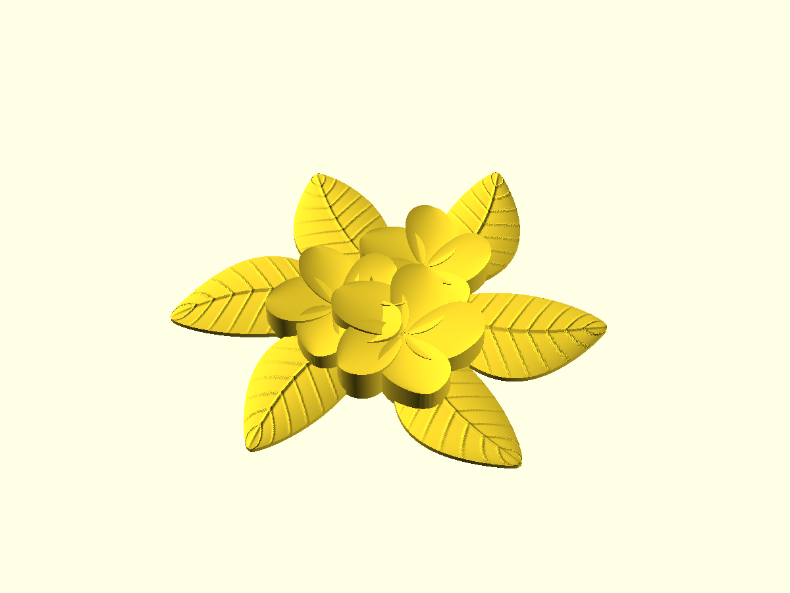

# Plumeria relief

A single-piece decorative relief of three overlapping five-petal plumeria flowers over six veined leaves, 165.0 × 159.83 × 17.35 mm, with a flat back at Z = 0. The mesh is one closed, watertight solid of 94.0 cm³ with no downward-facing surface above the bed, so it prints without supports.

`source/` is the editable source as received: `Plumeria_Single_Piece_Editable.blend` holds the printable mesh plus a hidden collection of the individual petals, throats and leaves; `build_relief.py` and `render_relief.py` regenerate them (see `PRINT_NOTES.txt`). `Plumeria_Single_Piece_165mm.stl` is the printable mesh exported from the `.blend`.

`plumeria-a1-mini.gcode.3mf` is the A1 mini plate: stock OrcaSlicer 0.16 mm Optimal with the notes' 3 walls, 5 top and 4 bottom layers and 15 % gyroid, supports off, centred unrotated on the textured PEI plate with the automatic brim. It estimates 2 h 36 m and 50.8 g of PLA.

`plumeria-two-colour-a1-mini.gcode.3mf` prints the same relief in two colours: filament 1 for the flowers, filament 2 for the leaves, with the same settings and the prime tower off (the relief leaves no room for one; the A1 mini purges into its chute). `source/split_colours.py` cuts the printable mesh into `Plumeria_Flowers_165mm.stl` and `Plumeria_Leaves_165mm.stl`: the flowers body is every column inside the flowers' outline grown by 0.3 mm, so the flowers' whole visible surface, including where they cover a leaf, takes the flower colour. The bodies are watertight and their volumes sum to the single piece's. It estimates 3 h 43 m, 29.9 g for the flowers and 25.8 g for the leaves, with 21 colour changes into the flower filament each purging about 133 mm³.

Run `nix-shell -p jq xvfb-run unzip --run './plumeria/slice.sh [single|two-colour]'` from the repository root, with `orca-slicer` on `PATH`, to regenerate either plate.

