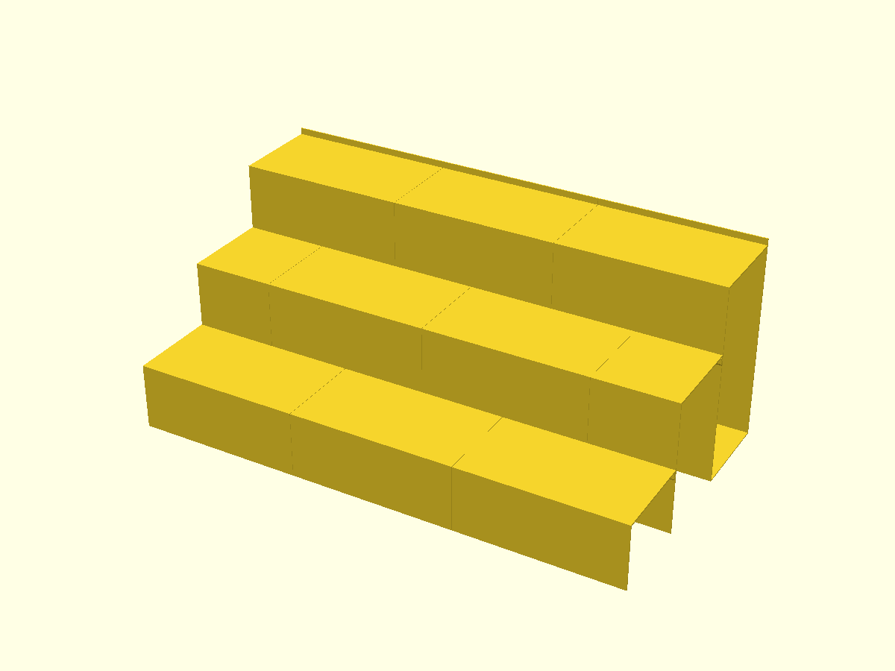
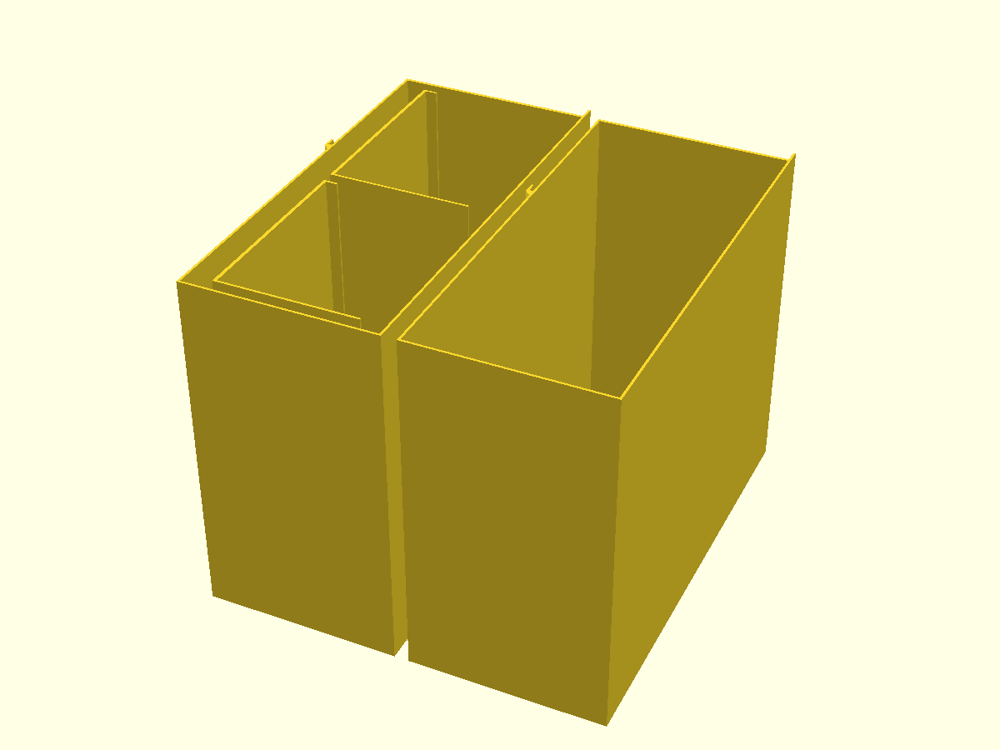
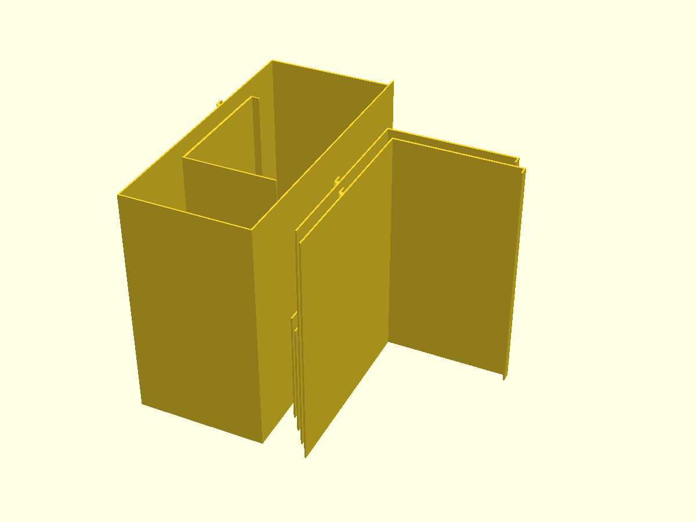

# Spice rack

Tiered spice rack for a shelf space 381 mm wide and 276.9 mm deep. Four rows of round jars, each row 50.8 mm higher than the one in front of it. The front row stands on the shelf and the back row stands 152.4 mm up. Each row holds seven 48 × 100 mm jars, so the rack holds 28.

| assembly | plate 1 | plate 2 |
|---|---|---|
|  |  |  |

The rack is built from thin walls, every one standing on the shelf. The back step is a closed rectangular tube: front wall, back wall, floor, and a tread with a 5 mm curb along its back edge. It stands on its own. The two lower steps are Γ sections: a 0.84 mm wall rising from the shelf, topped by a 1.2 mm tread that runs back to the step behind. A tab at the back of each tread drops into a catch on the front wall of that step: a channel 0.25 mm wider than the tab on each side, with the tab bottom resting on the channel floor. Nothing is glued.

To assemble, stand the back tubes, then drop each lower tier's tabs into the catches behind it. Across the width the pieces simply butt together. Tier 2 is cut half a segment off the other tiers, so each of its catches spans a seam in the row behind and in the row in front.

Every part is a straight extrusion of its section, printed standing on its cut end with no supports, bridges or overhangs. The A1 mini's 180 mm height limits a piece to 126.75 mm long, so each 381 mm row is three pieces, or two plus two half-length end pieces for tier 2. Tier 1 pieces print inside the back tubes, and the tier 2 sections nest diagonally.

| part | section (mm) | count |
|---|---|---|
| `tier1` | 69.0 × 50.8 | 3 |
| `tier2`, `tier2_end` | 71.2 × 101.6 | 2 + 2 |
| `tier3` | 72.3 × 157.4 | 3 |

`width`, `depth`, `top_height`, `jar_diameter`, `jar_height` and `rows` at the top of [spice-rack.scad](spice-rack.scad) set the size. Tread depth is `depth / rows` and the rise is `top_height / (rows - 1)`. Asserts reject:
- a tread too shallow for the jar,
- a rise too small for the joint,
- a tier 1 that will not fit inside a tube,
- a plate that overflows the bed.

[spice-rack-plate-1.gcode.3mf](spice-rack-plate-1.gcode.3mf) and [spice-rack-plate-2.gcode.3mf](spice-rack-plate-2.gcode.3mf) are sliced for a Bambu Lab A1 mini (0.4 mm nozzle, 0.20 mm Standard, PLA, textured PEI, Arachne walls, supports off). They have a 3 mm outer brim because the walls touch the plate only along lines.

| plate | pieces | filament | time |
|---|---|---|---|
| 1 | 2 × `tier3`, 2 × `tier1` | 150.4 g | 3 h 58 min |
| 2 | 1 × `tier3`, 2 × `tier2`, 2 × `tier2_end`, 1 × `tier1` | 150.9 g | 4 h 18 min |

Other structures, sliced with the same settings but classic walls:

| structure | filament | print time | plates |
|---|---|---|---|
| open-back version (Γ top step and a separate footed back wall) | 286.1 g | 8 h 11 min | 2 |
| that version with 1.2 mm walls and 1.6 mm treads | 413.8 g | 12 h 29 min | 2 |
| solid steps, each section filled at 15% infill | 2179 g | 64 h | 4 |

The open-back version was 15 g lighter, but its free-standing back wall tipped easily during assembly.

Strength:
- A 2.5 N jar at mid-span bends a 1.2 mm tread about 0.7 mm.
- The tallest Γ wall is tier 2's, 101.6 mm, braced at 46 mm by the catch that holds tier 1.
- The back step's walls are closed into a box.
